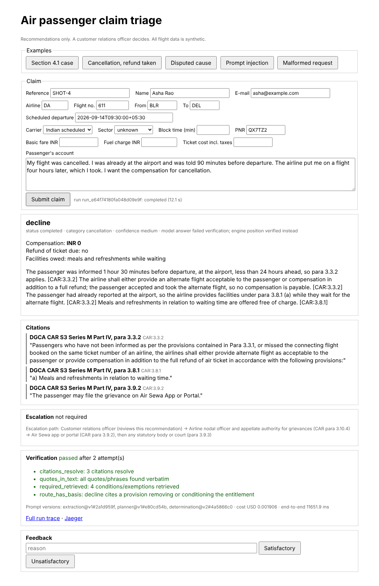

| Team member | SRN |
|---|---|
| Dhanush S S | PES1UG24AM082 |
| Mahipal S | PES1UG24AM153 |
| Vivaan A | PES1UG24AM071 |

Repository layout, how to run, and the demo script are in `README.md`. More detail is in:

* `docs/architecture.md` for the design;
* `docs/runbook.md` for operations;
* `docs/incident_log.md` for real failures we hit;
* `docs/slo.md` for the SLO, which we declared before any load test.

---

## 1. Problem and scope

Airlines receive claims for denied boarding, cancellation, long delay and downgrading. What the passenger is owed is
set by DGCA CAR Section 3, Series M, Part IV. It depends on several conditions at once: block time, notice, whether an
acceptable alternate flight was provided, contact details, and whether the cause was beyond the airline's control.

The service accepts a claim over REST, validates it, determines the entitlement from the CAR and routes it. The four
routes are pay-as-computed, request further evidence, decline with the cited provision, and escalate to a human.
Every route comes with clause-level citations whose quotes are checked against retrieved text. **The system never
authorises a payment.** It recommends, and a customer relations officer decides.

**The difficulty.** The amounts are easy to retrieve. The conditions that remove them sit around them, or in
provisions the claim never mentions. In the section 4.1 case the passenger was told of the cancellation at the
airport, so para 3.3.2 applies. That paragraph obliges the airline to provide *either* an alternate flight acceptable
to the passenger *or* compensation plus a full refund. The passenger took the alternate flight, so no compensation is
due. The same paragraph still requires facilities under para 3.8.1 (a) while the passenger waits, so meals are owed.
Our system answers **decline, INR 0, meals and refreshments owed**. It cites 3.3.2, 3.8.1 and the grievance path in
3.9.2 (Air Sewa), and passes verification (screenshot in §8).

**In scope.** The four disruption categories under the CAR. One airline charter, including where it conflicts with
the CAR. Every requirement F1–F8, A1–A8, L1–L6 and D1–D8 is addressed; the traceability table is in §9.

**Out of scope, and escalated rather than guessed.** Baggage, foreign carriers, refunds of ancillaries, and
anything not covered by the corpus.

**Corpus.** The CAR is the official DGCA PDF, `corpus/raw/dgca_car_s3_m_p4_rev4.pdf` (Issue I dated 6 Aug 2010,
Revision 4 dated 25 Jan 2023, effective 15 Feb 2023), marked `provenance: OFFICIAL` in `corpus/manifest.yaml`. It
chunks into 48 provisions. The airline charter ("Demo Air") is synthetic and deliberately conflicts with the CAR on
international downgrades. An earlier build used a working-text reconstruction because the sandbox could not reach
dgca.gov.in. Every number in this report was measured on the official PDF.

## 2. Agent design

**Topology (A2).** There are two agents in separate containers, connected by a queue.

1. **Intake agent** (`intake-agent`, no tools).
   * Runs guardrails: injection and toxicity detection, NFKC normalisation and spotlighting.
   * Classifies the disruption and extracts notice, block time, alternate flight, contact details and cause. A rule
     extractor and the model extraction prompt are merged, and structured fields win over the narrative.
   * Emits an `IntakeHandoff` (`contracts/intake_handoff.schema.json`) onto `runs:entitlement`. If injection was
     detected, the narrative is withheld from every later model call.
2. **Entitlement agent** (`agent-worker`, scalable). A LangGraph state machine:

```
plan ──(tool chosen)──────────▶ act ──▶ plan  (loop)
plan ──(finish / budget)───────▶ determine ──▶ verify
verify ──(pass)────────────────▶ finalize
verify ──(fail, attempts left)─▶ recover ──▶ plan  (new strategy)
verify ──(fail, exhausted)─────▶ fallback ──▶ finalize | escalate
```

**Tools (A1).** These are LangChain `StructuredTool`s, chosen by the planner and served by the retriever:

* `search_corpus`: hybrid or lexical search;
* `get_clause`: provision by id;
* `find_related`: walks the cross-reference graph in both directions, so it finds what a provision cites *and* which
  provisions cite it. Exemptions live in the second direction;
* `get_claim_fields`: the validated facts.

Retrieval is a tool call, never a fixed stage. The planner (model, prompt `planner@v1`) proposes actions. A checklist
guard refuses "finish" until two of the brief's steps are done: the provision that appears to apply has been
expanded (step 2, modifiers), and searches derived from text already read have run (step 3).

**Verification (A3).** Before anything is returned, `verifier.py` checks that:

* every citation resolves to a passage retrieved in this run;
* every quote and required phrase is verbatim in the cited text;
* the conditions and exemptions that could remove the entitlement were retrieved;
* the route has a basis: a decline cites a provision that removes compensation ("No such compensation shall be
  payable") or makes it conditional (3.3.2's either/or, 3.4.1's "facilities in accordance with Para 3.8.1 (a)"), and
  a payment cites an amount;
* a model answer cites the decisive provisions and agrees with the deterministic engine on route and amount.

On failure, `recover` *changes strategy*. It makes exact clause lookups for missing conditions, runs BM25 searches
on the failed phrases, and re-determines with the verifier's feedback. After `AGENT_MAX_VERIFY_ATTEMPTS`, the engine's
own position is verified. If that fails too, the run escalates. An unverified answer is never returned.

**Escalation (F7).** The run escalates when:

* the cause attribution is disputed;
* the CAR and the charter conflict and the charter is less favourable;
* the claim is outside the corpus (baggage, foreign carrier);
* injection was detected;
* verification is exhausted.

**Loop limits.**

| Limit | Default |
|---|---|
| Graph steps | 14 |
| Tool calls | 12 |
| Wall clock | 90 s |
| Verification attempts | 2 |
| LangGraph recursion limit | 100 |
| Consecutive tool errors before research stops | 3 |
| Reserved exact lookups for recovery and fallback | 6 |

The reserved lookups exist because a real model can spend the whole research budget. Without them, recovery never
ran and the fallback could not fetch the provisions it had to cite (INC-17). They are a separate hard bound, so the
loop still terminates. On the eval set with the stub, a run averages 11.7 steps, 9.7 tool calls and 12.4 model calls.

**Failure mid-run (A2).** A worker acks a message only after its step completes. If a replica dies, its message is
reclaimed by another with `XAUTOCLAIM` after 150 s and re-run; steps are idempotent. After 3 deliveries, or past the
120 s run deadline, the run is closed as `failed` and escalated, with no recommendation. If the provider fails, the
run degrades (§4). If the retriever fails, verification cannot pass and the run escalates. We drilled this: the run
ended `escalated` in 7.6 s (runbook, failure mode 2).

## 3. Architecture and deployment boundaries


**Why the boundaries are where they are (D3).**

| Boundary | Reason |
|---|---|
| `api` separate from agents | **Scaling and failure isolation.** The API does no model work, so it stays responsive while agents are saturated, and a crashed agent never takes submissions down. Requests queue in Redis instead |
| `intake-agent` and `agent-worker` | **Independent release and scaling.** Intake is cheap (1 model call). Entitlement is long (about 11 model calls, about 10 s), so it is the component we scale with `--scale agent-worker=3`. The hand-off is a published contract, so either side can be released alone |
| `retriever` separate | **Resource profile.** It holds the FAISS index and embedding model in memory (hundreds of MB with sentence-transformers). Putting it in every agent replica would multiply that memory and the model load time. It also hot-reloads a new index without restarting the agents |
| `llm-gateway` | **Failure isolation and security.** One place for the circuit breaker (shared state), budget, cost accounting and the API key. Changing provider is a configuration change to one service |
| `llm-stub` | Lets load tests measure our system, not the provider's rate limits (D6) |
| `ingest` as a job | Runs once per corpus change and exits. The retriever waits for it to complete successfully |
| State in `redis` and volumes | Every application service is stateless and can be replaced or scaled freely |

**Asynchronous execution (A4).** `POST /v1/claims` returns **202** with a `run_id` in about 10 ms. The caller polls
`GET /v1/runs/{id}`, or gives a `callback_url`. We chose polling as the baseline because it works through any proxy,
needs no client server, and the web client only needs a timer. Callbacks are for system integrations. Redis Streams
with consumer groups sit between submission and execution.

## 4. Design decisions and what we rejected

| Decision | Rejected alternative | Why |
|---|---|---|
| **LangGraph** explicit state machine | CrewAI role-play agents | Verification and recovery need deterministic routing (verify, then recover or fallback) and hard loop bounds. In LangGraph these are edges and counters, not prompt instructions |
| **Deterministic rule engine** as cross-check and fallback | Model-only determination; LLM-as-judge verification | A judge model costs another call per run and can agree with a wrong answer. Encoding the CAR conditions in `car_rules.yaml`, each tied to clause ids and required phrases, makes verification free and reproducible, and gives a degraded path when the provider is down |
| **One numbered provision per chunk**, plus a reference graph | Fixed 500-character windows | Windows separate 3.3.2's amounts from the either/or condition that decides whether they are owed. That is exactly the failure in section 3 of the brief. The naive baseline below shows it |
| **Hybrid FAISS + BM25 (RRF)** | Dense only | Clause numbers and exact terms ("block time", "alternate flight") match lexically, and passenger paraphrases match densely |
| **Redis Streams** | Celery + RabbitMQ | Redis is already needed for state, caches and the breaker. Streams give consumer groups, pending-entry reclaim and a dead-letter stream with no extra service |
| **Polling + optional callback** | Synchronous HTTP; WebSockets | Runs take about 10 s and can take up to 120 s, which is too long to hold a request. WebSockets add connection state for no benefit here |
| **LLM gateway service** | Provider SDK inside every worker | The breaker must be shared across replicas to be meaningful, and the key should live in one container |
| **Deterministic quality metrics** (TruLens-style triad, computed from text overlap and verbatim checks) | TruLens with an LLM judge | The brief allows "TruLens or equivalent". Ours are free, reproducible, run offline, and run on live samples at no cost. Definitions are in §5 |
| **A stub that answers naively** (pays INR 10,000 under 3.3.2 in the 4.1 case) | A stub that returns correct answers | So self-verification is really exercised in every demo and load test |
| **Single-process API** | `uvicorn --workers 2` | Prometheus counters were inconsistent across processes (INC-09). Scale with replicas instead |
| **Whole-run cache with single-flight** | Embedding cache only | Duplicate claims are common after a mass disruption. One run serves all copies (INC-08) |

## 5. Evaluation (L2, L3, L5)

**Eval set.** `eval/scenarios.yaml` has 27 scenarios, each with the expected route, amount, facilities, the clauses it
must cite, and the supporting passage. It includes S01, the section 4.1 case. It covers:

* cancellation with notice, alternate flight, contact details, weather (undisputed and disputed), and a technical
  fault decided by the general test;
* denied boarding: cap, volunteer, late check-in, refund;
* delay: meals, night hotel, and a cause the passenger disputes (3.4.4 removes facilities only for
  extraordinary circumstances);
* downgrade: domestic, international with a CAR/charter conflict, and passenger-requested;
* outside the corpus, and prompt injection.

Run it with `make eval-inprocess`, or `make eval` against the live stack.

**Metrics** (`src/triage/quality.py`).

| Metric | How it is computed |
|---|---|
| Groundedness | Share of justification sentences with at least 50% of their content words in a cited passage or in the fact sheet |
| Context relevance | Share of retrieved passages that are gold clauses or conditions and exemptions the category requires |
| Faithfulness | Share of the answer's atomic claims entailed by the cited passages: route basis, each facility, each quote verbatim, amount bounded by a cited figure |
| Hallucination rate | Share of runs with any unresolved citation, non-verbatim quote, or unbounded amount |

We also report accuracy (route, amount and facilities all correct).

**The deliberate change (L3).** Before the change, `find_related` also followed `sibling` and `definition` edges, and
up to 5 derived searches ran. That made context relevance 0.15. We restricted the edges to `referenced_by_this`,
`cites_this` and `cites_parent`, and capped derived searches at `DERIVED_K=3`. Both runs use the stub model, so the
only difference is retrieval.

| Metric (27 scenarios, official CAR, stub model) | Before | After | Change |
|---|---|---|---|
| Accuracy | 1.000 | 1.000 | 0 |
| **Groundedness** | 1.000 | 1.000 | 0 |
| **Context relevance** | 0.150 | **0.204** | **+36%** |
| **Faithfulness** | 1.000 | 1.000 | 0 |
| **Hallucination rate** | 0.000 | 0.000 | 0 |
| Context recall (required clauses retrieved) | 1.000 | 1.000 | 0 |
| Passages retrieved per run | 22.6 | 16.9 | −25% |
| Prompt tokens per run | 16,147 | 13,950 | −14% |
| Cost per 100 runs | $0.179 | $0.157 | −12% |

So the change removed noise and cost without losing any required condition.

**Baselines and ablations** (stub model).

| Configuration | Accuracy | Groundedness | Ctx relevance | Faithfulness | Hallucination | $/100 runs |
|---|---|---|---|---|---|---|
| **Naive RAG** (embed, top-5, answer) | 0.111 | 0.444 | 0.304 | 0.556 | 0.444 | $0.023 |
| Agent, no modifier search | 1.000 | 1.000 | 0.219 | 1.000 | 0.000 | $0.136 |
| Agent, no model (heuristic planner + engine) | 1.000 | 1.000 | 0.209 | 1.000 | 0.000 | $0.006 |
| **Agent (final)** | **1.000** | 1.000 | 0.204 | 1.000 | 0.000 | $0.157 |

* **Naive RAG** gets S01 wrong: it pays INR 10,000, which is the trap in the brief. Its context recall is 0.57, so it
  usually never sees the condition or exemption.
* **No modifier search** still scores 100%, but only because verification failed and recovery fetched the missing
  conditions. The safety net works, but it costs a second determination.

**Real model: Gemini (`gemini-3.5-flash-lite`, free tier).** We ran all 27 scenarios through the gateway with the
real model, determination prompt v2, paced to 14 requests per minute (`eval/results/gemini-full-det-v2.json`;
this run was before the INC-19 fix described below). One run of the eval set takes about 30 minutes
and about 390 model requests. Every run used the model: no run completed on the degraded path except S24, where one
call failed and the run still ended correctly.

| Metric (27 scenarios, official CAR) | Stub | Gemini |
|---|---|---|
| Accuracy (route, amount, facilities, escalation reason) | 1.000 | **0.889** (24/27) |
| Route accuracy | 1.000 | 1.000 |
| Groundedness | 1.000 | **0.636** |
| Context relevance | 0.204 | 0.184 |
| Faithfulness | 1.000 | 0.986 |
| Hallucination rate | 0.000 | 0.000 |
| Must-cite recall | 1.000 | 0.907 |
| Model answer verified on the first attempt | 0 / 27 | 8 / 27 |
| Model answer verified after recovery | 0 / 27 | 11 / 27 |
| Engine position returned (model draft rejected twice, or injection) | 27 / 27 | 8 / 27 |
| Tool calls per run | 9.7 | 12.9 |
| Prompt + completion tokens per run | 13,950 + 450 | 16,532 + 1,502 |
| Cost per 100 runs (configured price) | $0.157 | $0.225 |
| Mean time per run | 0.03 s | 61 s (mostly pacing) |

What the Gemini run taught us:

* **The route was right in all 27 cases, and nothing was hallucinated.** Every citation resolved and every quote was
  verbatim, because the verifier rejects anything else. In 8 cases the model's draft failed twice and the engine's
  verified position was returned. In S01 (the 4.1 case) the model first cited the airline charter instead of CAR
  3.3.2; recovery fetched 3.3.2 and the verified answer was decline, INR 0, meals owed.
* **Three answers were wrong in ways the verifier did not catch, and we fixed both causes.**
  * S18 (5-hour delay): the model correctly declined compensation but left out the meals that 3.4.1 requires, and the
    verifier only compared route and amount with the engine. `consistent_with_rules` now also fails an answer that
    drops a facility the engine finds owed (meals, hotel). Test: `test_verifier_rejects_answer_that_drops_owed_facilities`.
  * S09 and S23: the model escalated correctly, but in its own words, so the escalation category (general test,
    outside the corpus) was lost. A model escalation now carries the engine's fixed-wording reasons first, followed
    by the model's.
* **Groundedness fell to 0.64.** The model's justification paraphrases the provisions, so fewer sentences share half
  their content words with a cited passage. The citations and amounts are verified; the explanatory prose is not.
  The next step would be to check each justification sentence, or to compose the justification from the verified
  components.
* **The free tier is the binding limit.** Gemini allows 15 requests per minute and 500 requests per day for this
  model. A run makes about 14 model calls, so the free tier supports about one run per minute and about 35 runs a
  day. Our second full run (prompt v1) hit the daily limit on its first scenario.

**Prompt comparison on Gemini (L2).** Prompts are versioned YAML (`prompts/<id>/<version>.yaml`), and each result
records `id@version#sha8`. Determination v2 adds a section that feeds the verifier's failures back to the model on a
retry. Under the stub, v1 and v2 tie on quality by construction (the stub ignores the prompt); v2 costs 4% more
($0.152 vs $0.157 per 100 runs). The real-model comparison is below.

*The Gemini comparison of v1 and v2 on a 13-scenario subset is scheduled for after the free-tier daily quota
resets; this section will be updated with its numbers.*

**Cost (L5).** Tokens and cost are recorded at call time, per step and per run. The gateway applies the configured
price, $0.10 / $0.40 per 1M prompt / completion tokens. We have not confirmed that this is the list price of
`gemini-3.5-flash-lite`; we ran on the free tier, so our actual spend was $0.

| Stub model (27 scenarios) | Value |
|---|---|
| Cost per run | $0.00157 (13,950 prompt + 450 completion tokens, 12.4 calls) |
| **Cost per 100 runs** | **$0.157** |
| Share by step | planner 59%, determination 37%, extraction 4% |

**The largest cost driver is the planner.** It makes about 11 calls per run, and each one resends the current
evidence summary. Two options would reduce it: plan two tool calls per model call, or let the checklist handle the
predictable early steps (the no-model run shows it can).

**Honest reading of the stub numbers.** With the stub, no model draft passed verification on its first attempt, and
every final answer came from recovery or from the engine's verified position. The stub's 100% therefore measures the
agent loop, verifier and rule engine working together, not a language model. The Gemini runs above measure the model.

## 6. Performance: SLO, load test, bottleneck (D6, D7, A7)

These load tests were run with the stub model before the corpus was replaced by the official PDF. The run shape that
sets throughput is unchanged (about 12 model calls and 10 tool calls per run, 12.4 vs 12.4 calls before), so we did
not repeat them. With Gemini's free tier the system is limited by the provider at 14 requests per minute, about one
run per minute, which the pacing in the gateway enforces.

**SLO (declared first, `docs/slo.md`, committed before any Locust run).** A complete run (submit until the result is
available) must have **p95 ≤ 30 s at 2 runs/s, with under 1% of runs failing**. The model is the stub at 0.8 s ± 35%
per call. Locust reports a custom `full_run` request, and claims are randomised so the cache does not serve them.

| Replicas × concurrency | Users | Runs/s | p50 | p95 | Failures | SLO |
|---|---|---|---|---|---|---|
| 1 × 4 | 5 | 0.34 | 12 s | 16 s | 0 | met |
| 1 × 4 | 10 | 0.36 | 23 s | 29 s | 0 | met |
| 1 × 4 | 20 | 0.30 | 48 s | **67 s** | 0 | **missed** |
| **3 × 4** | 10 | 0.73 | 11 s | 13 s | 0 | met |
| 3 × 4 | 20 | 1.10 | 15 s | 23 s | 0 | met |
| 3 × 4 | 40 | 1.06 | 31 s | **44 s** | 0 | **missed** |
| 3 × 16 | 40 | 3.22 | 11 s | 13 s | 0 | met |
| 3 × 16 | 80 | **4.47** | 15 s | 21 s | 0 | **met (2.2× the target rate)** |
| 3 × 16 | 160 | 4.53 | 31 s | **37 s** | 0 | **missed** |
| 3 × 16 | 240 | 3.59 | 49 s | 77 s | 0 | missed |

Raw CSVs are in `loadtest/results/`.

**Effect of `--scale agent-worker=3` (A7).** At 20 users, throughput rose from 0.30 to 1.10 runs/s (3.7×) and p95
fell from 67 s to 23 s. The SLO failure point moved from about 20 users to about 40 users. With the default
concurrency of 4, three replicas still peaked at 1.1 runs/s, below the 2 runs/s target. **The target was met only
after raising `WORKER_CONCURRENCY` to 16.**

**Bottleneck.** The limit is the number of agent slots (replicas × concurrency), each held for about 11 s by a run
that makes about 12 sequential model calls. The measured plateaus match slots ÷ 11 s:

| Slots | Predicted (slots ÷ 11 s) | Measured |
|---|---|---|
| 4 | 0.36 runs/s | 0.36 |
| 12 | 1.09 runs/s | 1.10 |
| 48 | 4.4 runs/s | 4.5 |

CPU stayed under 0.4 cores per container (dashboard). Past the plateau, runs simply wait in `runs:entitlement`
(queue depth panel), and p95 grows with queue time. **At 3 × 16 the target fails at about 160 concurrent users
(4.5 runs/s), and the responsible component is the agent-worker slot pool.**

The next limits are the gateway and API polling. Gateway p95 rose to 1.8 s against about 1.26 s expected from the
stub. With a real free tier, the provider's rate limit would bind long before either, which is exactly why the
breaker, budget and caching exist.

**Caching and rate limiting (D7).**

* **Whole-run cache.** The key is the normalised claim plus prompt versions, agent modes, model id, rule-map hash and
  index version (INC-20), with a TTL of 24 h and
  single-flight coalescing. At 40 users with repeated claims: **p95 34 ms (vs 13 s uncached), 16.4 runs/s, cost per
  cached run $0** (vs $0.00157 on the current corpus). Cost per run scales with (1 − hit rate). Only verified, non-degraded results are
  cached.
* **Retrieval cache.** Redis, keyed by query, mode, k and index version. Every lookup was a hit after warm-up under
  load.
* **Query-embedding cache.** An in-process LRU.
* **Rate limiting.** A token bucket per `X-Client-Id` (120 per minute, burst 30) plus at most 200 runs in flight per
  client, returning HTTP 429 with `Retry-After`. Without the limit, one client looping on distinct claims is bounded
  only by agent capacity (4.5 runs/s, about $25 an hour at our cost per run). With it, the client is held to 2 runs/s
  sustained, about $11 an hour, and repeats of the same claim cost $0 through the cache. The gateway's daily budget
  (`LLM_DAILY_BUDGET_USD`, default $5) is the final stop.

## 7. What did not work, and what we would do next

* **Moving to the official PDF broke more than we expected.** The first build used a working-text reconstruction
  because the sandbox could not reach dgca.gov.in. On the official PDF, wrapped cross-references ("Para" / "3.8.1
  (a).") became duplicate clauses, and running page headers sat inside provisions (INC-12, INC-13). Worse, 42 of the
  rule map's 65 required phrases were not in the official text, because the real CAR is organised differently: the
  extraordinary circumstances are in 1.4 and 1.5, facilities are in 3.8.1, and 3.3.2 is an either/or (INC-14). The
  verifier did what it was designed to do and refused to cite text that was not there, but the rule map had to be
  rewritten. A test now fails if any rule phrase is missing from its clause.
* **The first Gemini evaluation was silently invalid.** The free tier allows 15 requests per minute. A run makes
  about 13 calls in seconds, so 429 errors opened the breaker and every run completed on the degraded path, with a
  perfect score. We caught it from the prompt-token count (74 per run). The gateway now paces itself to
  `LLM_MAX_RPM` (INC-16).
* **A real model spent the research budget, so recovery never ran** (INC-17). We added a separate allowance of
  reserved exact lookups.
* **The stub hid two verifier gaps.** Gemini produced answers with the right route that dropped owed meals or lost
  the escalation category, and the verifier accepted them (INC-19). The free-tier daily limit then cut the prompt
  comparison short (INC-18).
* **The run cache outlived the corpus.** Its key did not include the index version or the rule map, so the old
  answer to the 4.1 case was still being served after the official CAR went in (INC-20).
* **Real embeddings were not measured.** The PyTorch index and Hugging Face were blocked, so every figure here uses
  the hashing fallback. BM25 compensates in this small corpus. On a normal machine, all-MiniLM-L6-v2 is the default.
* **The first verifier was too lenient.** It accepted a correct amount cited from the wrong provision (S12, S16). We
  added `cites_decisive_provision` (INC-05).
* **Chunking bugs.** A wrapped line ("5 hours;") was read as a new clause. A changed chunker was then not detected on
  re-ingest (INC-01, INC-02).
* **Cache stampede.** The first cache made p95 *no better* under load, because concurrent identical claims all
  missed. Single-flight fixed it (INC-08).
* **Scaling replicas alone did not reach the target.** Three replicas at concurrency 4 peaked at 1.1 runs/s. The
  bottleneck was slots per replica, not CPU.
* **Context relevance is still modest (0.20).** The agent deliberately reads definitions and neighbouring conditions,
  and the gold set counts only the required clauses. A reranker, or tighter derived queries, would be the next
  change.
* **The planner is the cost driver** (59% with the stub). Batching tool choices would cut model calls roughly in half.

## 8. Demonstration evidence

All ten demo items in section 9 of the brief were run against the live stack with `make demo`.

1. **Clean start.** `cp .env.example .env && docker compose up -d` runs the ingest job, then brings up 10 healthy
   long-running services (12 containers with three agent-workers).
2. **Valid request.** It routes `pay_as_computed` with citations that resolve to retrieved text.
3. **One run traced end to end.** The trace has 48 events with every tool call, passage, prompt version, tokens, cost
   and latency. The Jaeger trace has 168 spans across 6 services.
4. **Malformed request.** HTTP 422 with field-level errors, the quarantine count goes up by 1, and no `run_id` is
   issued.
5. **Outside the corpus.** Baggage and a foreign carrier both escalate.
6. **Self-verification.** The stub's draft (pay INR 10,000) fails `consistent_with_rules`, because the provisions give decline, INR 0.
   Recovery runs exact lookups and BM25 searches, then re-determines. The second draft fails again, so the engine's
   position is verified on its own and returned.
7. **Prompt injection.** The narrative is withheld from model calls (no extraction call is made), and the run is
   escalated with the `prompt_injection` flag.
8. **Circuit breaker.** With the stub in `error` mode, the breaker opens after 5 failures. Runs complete degraded and
   verified. After the stub is restored, the half-open trial succeeds and the breaker closes.
9. **Locust.** See the tables in §6.
10. **The section 4.1 case** (screenshot below): decline, INR 0, meals and refreshments owed, verification passed.



## 9. Requirement traceability

| Req | Where |
|---|---|
| F1, F2, D1 | `contracts/` (JSON Schemas and `CONTRACTS.md`), `src/triage/contracts.py`, `POST /v1/claims`, `GET /v1/quarantine` |
| F3 | `agents/intake.py`, `extraction.py`, `prompts/extraction/` |
| F4, F5, F6, A1, A3 | `agents/entitlement.py`, `agents/verifier.py`, `rules/` |
| F7 | Escalation conditions in `rules/car_rules.yaml` and the verifier fallback; scenarios S08, S09, S22–S25 |
| F8, D5, A6 | `/health`, `/ready` and `/metrics` on every service; JSON logs; `tracing.py`; `observability/` |
| A2 | `services/workers.py` (two agents, hand-off contract, reclaim and dead-letter handling) |
| A4 | `services/api.py`, `queue.py` |
| A5 | `services/llm_gateway.py` (breaker), `resilience.py`, the degraded path in `entitlement.py` |
| A7, D6 | `loadtest/`, `docs/slo.md`, §6 |
| A8 | `services/static/index.html`, served at <http://localhost:8080> |
| L1, D2 | `retrieval/`, `docs/architecture.md` §4 |
| L2 | `prompts/`, `prompts.py`, `eval/results/L2-*.json` (stub), `eval/results/gemini-*.json` (Gemini) |
| L3 | `eval/scenarios.yaml`, `eval/run_eval.py`, `quality.py`, `eval/results/L3-*.json` |
| L4 | `guardrails.py` |
| L5 | `llm_client.py` and the gateway's cost accounting; cost appears in every result and trace |
| L6 | `POST /v1/runs/{id}/feedback`, `GET /v1/feedback/summary`, `GET /v1/quality`, live sampling in the workers |
| D3 | `docker-compose.yml` (11 services with health checks and dependencies, plus `eval` and `locust` under profiles) |
| D4 | `.env.example`, `.gitignore`; the code has no default endpoints or models |
| D7 | `store.py` (run cache, rate limiter), `retrieval/embeddings.py`, `retriever_app.py` |
| D8 | `docs/runbook.md`, `docs/incident_log.md` |
