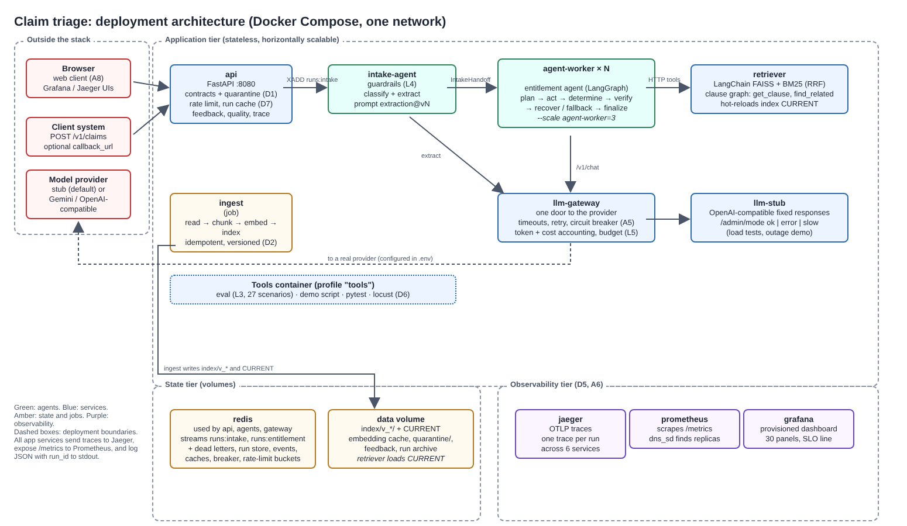

| Team member | SRN |
|---|---|
| Dhanush S S | PES1UG24AM082 |
| Mahipal S | PES1UG24AM153 |
| Vivaan A | PES1UG24AM071 |

Repository layout, how to run, and the demo script are in `README.md`. More detail is in:

* `docs/architecture.md` for the design;
* `docs/runbook.md` for operations;
* `docs/incident_log.md` for real failures we hit;
* `docs/slo.md` for the SLO, which we declared before any load test.

---

## 1. Problem and scope

Airlines receive claims for denied boarding, cancellation, long delay and downgrading. What the passenger is owed is
set by DGCA CAR Section 3, Series M, Part IV. It depends on several conditions at once: block time, notice, whether an
acceptable alternate flight was provided, contact details, and whether the cause was beyond the airline's control.

The service accepts a claim over REST, validates it, determines the entitlement from the CAR and routes it. The four
routes are pay-as-computed, request further evidence, decline with the cited provision, and escalate to a human.
Every route comes with clause-level citations whose quotes are checked against retrieved text. **The system never
authorises a payment.** It recommends, and a customer relations officer decides.

**The difficulty.** The amounts are easy to retrieve. The conditions that remove them sit around them, or in
provisions the claim never mentions. In the section 4.1 case the passenger took the alternate flight, so 3.3.2 pays
no compensation, but the facilities provision 3.4.1, which 3.3.2 refers to, still owes meals. Our system answers
**decline, INR 0, meals and refreshments owed**. It cites 3.3.2, 3.4.1, the definition in 2.1 and the grievance
path in 3.8.1, and passes verification (screenshot in §8).

**In scope.** The four disruption categories under the CAR. One airline charter, including where it conflicts with
the CAR. Every requirement F1–F8, A1–A8, L1–L6 and D1–D8 is addressed; the traceability table is in §9.

**Out of scope, and escalated rather than guessed.** Baggage, foreign carriers, refunds of ancillaries, and
anything not covered by the corpus.

**Corpus caveat.** The build environment could not download from dgca.gov.in. `corpus/raw/dgca_car_s3_m_p4.md` is
therefore a working-text reconstruction of the CAR's structure and provisions, marked `provenance: WORKING-TEXT`.
The airline charter ("Demo Air") is synthetic and deliberately conflicts with the CAR on international downgrades.
Swapping in the official PDF takes one manifest edit and `make ingest` (README §6). The chunker reads PDFs with a
text layer.

## 2. Agent design

**Topology (A2).** There are two agents in separate containers, connected by a queue.

1. **Intake agent** (`intake-agent`, no tools).
   * Runs guardrails: injection and toxicity detection, NFKC normalisation and spotlighting.
   * Classifies the disruption and extracts notice, block time, alternate flight, contact details and cause. A rule
     extractor and the model extraction prompt are merged, and structured fields win over the narrative.
   * Emits an `IntakeHandoff` (`contracts/intake_handoff.schema.json`) onto `runs:entitlement`. If injection was
     detected, the narrative is withheld from every later model call.
2. **Entitlement agent** (`agent-worker`, scalable). A LangGraph state machine:

```
plan ──(tool chosen)──────────▶ act ──▶ plan  (loop)
plan ──(finish / budget)───────▶ determine ──▶ verify
verify ──(pass)────────────────▶ finalize
verify ──(fail, attempts left)─▶ recover ──▶ plan  (new strategy)
verify ──(fail, exhausted)─────▶ fallback ──▶ finalize | escalate
```

**Tools (A1).** These are LangChain `StructuredTool`s, chosen by the planner and served by the retriever:

* `search_corpus`: hybrid or lexical search;
* `get_clause`: provision by id;
* `find_related`: walks the cross-reference graph in both directions, so it finds what a provision cites *and* which
  provisions cite it. Exemptions live in the second direction;
* `get_claim_fields`: the validated facts.

Retrieval is a tool call, never a fixed stage. The planner (model, prompt `planner@v1`) proposes actions. A checklist
guard refuses "finish" until two of the brief's steps are done: the provision that appears to apply has been
expanded (step 2, modifiers), and searches derived from text already read have run (step 3).

**Verification (A3).** Before anything is returned, `verifier.py` checks that:

* every citation resolves to a passage retrieved in this run;
* every quote and required phrase is verbatim in the cited text;
* the conditions and exemptions that could remove the entitlement were retrieved;
* the route has a basis: a decline cites a negative condition, a payment cites an amount;
* a model answer cites the decisive provisions and agrees with the deterministic engine on route and amount.

On failure, `recover` *changes strategy*. It makes exact clause lookups for missing conditions, runs BM25 searches
on the failed phrases, and re-determines with the verifier's feedback. After `AGENT_MAX_VERIFY_ATTEMPTS`, the engine's
own position is verified. If that fails too, the run escalates. An unverified answer is never returned.

**Escalation (F7).** The run escalates when:

* the cause attribution is disputed;
* the CAR and the charter conflict and the charter is less favourable;
* the claim is outside the corpus (baggage, foreign carrier);
* injection was detected;
* verification is exhausted.

**Loop limits.**

| Limit | Default |
|---|---|
| Graph steps | 14 |
| Tool calls | 12 |
| Wall clock | 90 s |
| Verification attempts | 2 |
| LangGraph recursion limit | 100 |
| Consecutive tool errors before research stops | 3 |

On the eval set a run averages 11.6 steps, 9.6 tool calls and 12.4 model calls.

**Failure mid-run (A2).** A worker acks a message only after its step completes. If a replica dies, its message is
reclaimed by another with `XAUTOCLAIM` after 150 s and re-run; steps are idempotent. After 3 deliveries, or past the
120 s run deadline, the run is closed as `failed` and escalated, with no recommendation. If the provider fails, the
run degrades (§4). If the retriever fails, verification cannot pass and the run escalates. We drilled this: the run
ended `escalated` in 7.6 s (runbook, failure mode 2).

## 3. Architecture and deployment boundaries



**Why the boundaries are where they are (D3).**

| Boundary | Reason |
|---|---|
| `api` separate from agents | **Scaling and failure isolation.** The API does no model work, so it stays responsive while agents are saturated, and a crashed agent never takes submissions down. Requests queue in Redis instead |
| `intake-agent` and `agent-worker` | **Independent release and scaling.** Intake is cheap (1 model call). Entitlement is long (about 11 model calls, about 10 s), so it is the component we scale with `--scale agent-worker=3`. The hand-off is a published contract, so either side can be released alone |
| `retriever` separate | **Resource profile.** It holds the FAISS index and embedding model in memory (hundreds of MB with sentence-transformers). Putting it in every agent replica would multiply that memory and the model load time. It also hot-reloads a new index without restarting the agents |
| `llm-gateway` | **Failure isolation and security.** One place for the circuit breaker (shared state), budget, cost accounting and the API key. Changing provider is a configuration change to one service |
| `llm-stub` | Lets load tests measure our system, not the provider's rate limits (D6) |
| `ingest` as a job | Runs once per corpus change and exits. The retriever waits for it to complete successfully |
| State in `redis` and volumes | Every application service is stateless and can be replaced or scaled freely |

**Asynchronous execution (A4).** `POST /v1/claims` returns **202** with a `run_id` in about 10 ms. The caller polls
`GET /v1/runs/{id}`, or gives a `callback_url`. We chose polling as the baseline because it works through any proxy,
needs no client server, and the web client only needs a timer. Callbacks are for system integrations. Redis Streams
with consumer groups sit between submission and execution.

## 4. Design decisions and what we rejected

| Decision | Rejected alternative | Why |
|---|---|---|
| **LangGraph** explicit state machine | CrewAI role-play agents | Verification and recovery need deterministic routing (verify, then recover or fallback) and hard loop bounds. In LangGraph these are edges and counters, not prompt instructions |
| **Deterministic rule engine** as cross-check and fallback | Model-only determination; LLM-as-judge verification | A judge model costs another call per run and can agree with a wrong answer. Encoding the CAR conditions in `car_rules.yaml`, each tied to clause ids and required phrases, makes verification free and reproducible, and gives a degraded path when the provider is down |
| **One numbered provision per chunk**, plus a reference graph | Fixed 500-character windows | Windows separate 3.3.2's amounts from the condition that cancels them. That is exactly the failure in section 3 of the brief. The naive baseline below shows it |
| **Hybrid FAISS + BM25 (RRF)** | Dense only | Clause numbers and exact terms ("block time", "alternate flight") match lexically, and passenger paraphrases match densely |
| **Redis Streams** | Celery + RabbitMQ | Redis is already needed for state, caches and the breaker. Streams give consumer groups, pending-entry reclaim and a dead-letter stream with no extra service |
| **Polling + optional callback** | Synchronous HTTP; WebSockets | Runs take about 10 s and can take up to 120 s, which is too long to hold a request. WebSockets add connection state for no benefit here |
| **LLM gateway service** | Provider SDK inside every worker | The breaker must be shared across replicas to be meaningful, and the key should live in one container |
| **Deterministic quality metrics** (TruLens-style triad, computed from text overlap and verbatim checks) | TruLens with an LLM judge | The brief allows "TruLens or equivalent". Ours are free, reproducible, run offline, and run on live samples at no cost. Definitions are in §5 |
| **A stub that answers naively** (pays INR 10,000 under 3.3.2 in the 4.1 case) | A stub that returns correct answers | So self-verification is really exercised in every demo and load test |
| **Single-process API** | `uvicorn --workers 2` | Prometheus counters were inconsistent across processes (INC-09). Scale with replicas instead |
| **Whole-run cache with single-flight** | Embedding cache only | Duplicate claims are common after a mass disruption. One run serves all copies (INC-08) |

## 5. Evaluation (L2, L3, L5)

**Eval set.** `eval/scenarios.yaml` has 27 scenarios, each with the expected route, amount, facilities, the clauses it
must cite, and the supporting passage. It includes S01, the section 4.1 case. It covers:

* cancellation with notice, alternate flight, contact details, weather (undisputed and disputed), and a technical
  fault decided by the general test;
* denied boarding: cap, volunteer, late check-in, refund;
* delay: meals and night hotel;
* downgrade: domestic, international with a CAR/charter conflict, and passenger-requested;
* outside the corpus, and prompt injection.

Run it with `make eval-inprocess`, or `make eval` against the live stack.

**Metrics** (`src/triage/quality.py`).

| Metric | How it is computed |
|---|---|
| Groundedness | Share of justification sentences with at least 50% of their content words in a cited passage or in the fact sheet |
| Context relevance | Share of retrieved passages that are gold clauses or conditions and exemptions the category requires |
| Faithfulness | Share of the answer's atomic claims entailed by the cited passages: route basis, each facility, each quote verbatim, amount bounded by a cited figure |
| Hallucination rate | Share of runs with any unresolved citation, non-verbatim quote, or unbounded amount |

We also report accuracy (route, amount and facilities all correct).

**The deliberate change (L3).** Before the change, `find_related` also followed `sibling` and `definition` edges, and
up to 5 derived searches ran. That made context relevance 0.16. We restricted the edges to `referenced_by_this`,
`cites_this` and `cites_parent`, and capped derived searches at `DERIVED_K=3`.

| Metric (27 scenarios) | Before | After | Change |
|---|---|---|---|
| Accuracy | 1.000 | 1.000 | 0 |
| **Groundedness** | 1.000 | 1.000 | 0 |
| **Context relevance** | 0.162 | **0.231** | **+43%** |
| **Faithfulness** | 1.000 | 1.000 | 0 |
| **Hallucination rate** | 0.000 | 0.000 | 0 |
| Passages retrieved per run | 23.6 | 17.0 | −28% |
| Prompt tokens per run | 16,080 | 13,836 | −14% |
| Cost per 100 runs | $0.179 | $0.156 | −13% |

So the change removed noise and cost without losing any required condition: context recall stayed at 1.0.

**Baselines and ablations.**

| Configuration | Accuracy | Groundedness | Ctx relevance | Faithfulness | Hallucination | $/100 runs |
|---|---|---|---|---|---|---|
| **Naive RAG** (embed, top-5, answer) | 0.111 | 0.444 | 0.304 | 0.556 | 0.444 | $0.023 |
| Agent, no modifier search | 1.000 | 1.000 | 0.247 | 1.000 | 0.000 | $0.132 |
| Agent, no model (heuristic planner + engine) | 1.000 | 1.000 | 0.240 | 1.000 | 0.000 | $0.006 |
| **Agent (final)** | **1.000** | 1.000 | 0.231 | 1.000 | 0.000 | $0.156 |

* **Naive RAG** gets S01 wrong: it pays INR 10,000, which is the trap in the brief.
* **No modifier search** still scores 100%, but only because verification failed and recovery fetched the missing
  conditions. The safety net works, but it costs a second determination.

**Prompt comparison (L2).** Prompts are versioned YAML (`prompts/<id>/<version>.yaml`), and each result records
`id@version#sha8`. Under the stub, determination v1 and v2 give **identical** quality, because the stub returns
fixed text whatever the prompt says. v2 adds a verification-feedback section, which costs +4% prompt tokens ($0.151
vs $0.156 per 100 runs). Extraction v2 vs v1 is +1.6% tokens with no quality change. **A meaningful quality comparison
needs a real model.** It is one command once a free-tier key is in `.env` (README §5).

**Cost (L5).** Tokens and cost are recorded at call time, per step and per run. The gateway applies the configured
price; we used $0.10 / $0.40 per 1M tokens, Gemini 2.0 Flash list price.

| | Value |
|---|---|
| Cost per run | $0.00156 (13,836 prompt + 453 completion tokens, 12.4 calls) |
| **Cost per 100 runs** | **$0.156** |
| Share by step | planner 61%, determination 35%, extraction 4% |

**The largest cost driver is the planner.** It makes about 11 calls per run, and each one resends the current
evidence summary. Two options would reduce it: plan two tool calls per model call, or let the checklist handle the
predictable early steps (the no-model run shows it can).

**Honest reading of these numbers.** Every scenario reached its final answer via recovery or fallback. In 26 of 27,
the stub's fixed model draft failed verification and the engine's verified position was returned. The 100% accuracy
therefore measures the agent loop, verifier and rule engine working together. It does not measure a language model.
With a real model, more drafts should pass on the first attempt and the cost per run should fall.

## 6. Performance: SLO, load test, bottleneck (D6, D7, A7)

**SLO (declared first, `docs/slo.md`, committed before any Locust run).** A complete run (submit until the result is
available) must have **p95 ≤ 30 s at 2 runs/s, with under 1% of runs failing**. The model is the stub at 0.8 s ± 35%
per call. Locust reports a custom `full_run` request, and claims are randomised so the cache does not serve them.

| Replicas × concurrency | Users | Runs/s | p50 | p95 | Failures | SLO |
|---|---|---|---|---|---|---|
| 1 × 4 | 5 | 0.34 | 12 s | 16 s | 0 | met |
| 1 × 4 | 10 | 0.36 | 23 s | 29 s | 0 | met |
| 1 × 4 | 20 | 0.30 | 48 s | **67 s** | 0 | **missed** |
| **3 × 4** | 10 | 0.73 | 11 s | 13 s | 0 | met |
| 3 × 4 | 20 | 1.10 | 15 s | 23 s | 0 | met |
| 3 × 4 | 40 | 1.06 | 31 s | **44 s** | 0 | **missed** |
| 3 × 16 | 40 | 3.22 | 11 s | 13 s | 0 | met |
| 3 × 16 | 80 | **4.47** | 15 s | 21 s | 0 | **met (2.2× the target rate)** |
| 3 × 16 | 160 | 4.53 | 31 s | **37 s** | 0 | **missed** |
| 3 × 16 | 240 | 3.59 | 49 s | 77 s | 0 | missed |

Raw CSVs are in `loadtest/results/`.

**Effect of `--scale agent-worker=3` (A7).** At 20 users, throughput rose from 0.30 to 1.10 runs/s (3.7×) and p95
fell from 67 s to 23 s. The SLO failure point moved from about 20 users to about 40 users. With the default
concurrency of 4, three replicas still peaked at 1.1 runs/s, below the 2 runs/s target. **The target was met only
after raising `WORKER_CONCURRENCY` to 16.**

**Bottleneck.** The limit is the number of agent slots (replicas × concurrency), each held for about 11 s by a run
that makes about 12 sequential model calls. The measured plateaus match slots ÷ 11 s:

| Slots | Predicted (slots ÷ 11 s) | Measured |
|---|---|---|
| 4 | 0.36 runs/s | 0.36 |
| 12 | 1.09 runs/s | 1.10 |
| 48 | 4.4 runs/s | 4.5 |

CPU stayed under 0.4 cores per container (dashboard). Past the plateau, runs simply wait in `runs:entitlement`
(queue depth panel), and p95 grows with queue time. **At 3 × 16 the target fails at about 160 concurrent users
(4.5 runs/s), and the responsible component is the agent-worker slot pool.**

The next limits are the gateway and API polling. Gateway p95 rose to 1.8 s against about 1.26 s expected from the
stub. With a real free tier, the provider's rate limit would bind long before either, which is exactly why the
breaker, budget and caching exist.

**Caching and rate limiting (D7).**

* **Whole-run cache.** The key is the normalised claim plus prompt versions, agent modes and model id, with a TTL of 24 h and
  single-flight coalescing. At 40 users with repeated claims: **p95 34 ms (vs 13 s uncached), 16.4 runs/s, cost per
  cached run $0** (vs $0.00156). Cost per run scales with (1 − hit rate). Only verified, non-degraded results are
  cached.
* **Retrieval cache.** Redis, keyed by query, mode, k and index version. Every lookup was a hit after warm-up under
  load.
* **Query-embedding cache.** An in-process LRU.
* **Rate limiting.** A token bucket per `X-Client-Id` (120 per minute, burst 30) plus at most 200 runs in flight per
  client, returning HTTP 429 with `Retry-After`. Without the limit, one client looping on distinct claims is bounded
  only by agent capacity (4.5 runs/s, about $25 an hour at our cost per run). With it, the client is held to 2 runs/s
  sustained, about $11 an hour, and repeats of the same claim cost $0 through the cache. The gateway's daily budget
  (`LLM_DAILY_BUDGET_USD`, default $5) is the final stop.

## 7. What did not work, and what we would do next

* **The official corpus.** The build sandbox could not reach dgca.gov.in, so we built against a working-text
  reconstruction and a synthetic charter. The demo should use the official PDF (README §6), followed by a re-run of
  `make eval`.
* **The prompt comparison is not informative under the stub.** v1 and v2 tie on quality by construction. It needs a
  real-model run.
* **Real embeddings were not measured.** The PyTorch index and Hugging Face were blocked, so every figure here uses
  the hashing fallback. BM25 compensates in this small corpus. On a normal machine, all-MiniLM-L6-v2 is the default.
* **The first verifier was too lenient.** It accepted a correct amount cited from the wrong provision (S12, S16). We
  added `cites_decisive_provision` (INC-05).
* **Chunking bugs.** A wrapped line ("5 hours;") was read as a new clause. A changed chunker was then not detected on
  re-ingest (INC-01, INC-02).
* **Cache stampede.** The first cache made p95 *no better* under load, because concurrent identical claims all
  missed. Single-flight fixed it (INC-08).
* **Scaling replicas alone did not reach the target.** Three replicas at concurrency 4 peaked at 1.1 runs/s. The
  bottleneck was slots per replica, not CPU.
* **Context relevance is still modest (0.23).** The agent deliberately reads definitions and neighbouring conditions,
  and the gold set counts only the required clauses. A reranker, or tighter derived queries, would be the next
  change.
* **The planner is the cost driver** (61%). Batching tool choices would cut model calls roughly in half.

## 8. Demonstration evidence

All ten demo items in section 9 of the brief were run against the live stack with `make demo`.

1. **Clean start.** `cp .env.example .env && docker compose up -d` runs the ingest job, then brings up 10 healthy
   long-running services (12 containers with three agent-workers).
2. **Valid request.** It routes `pay_as_computed` with citations that resolve to retrieved text.
3. **One run traced end to end.** The trace has 48 events with every tool call, passage, prompt version, tokens, cost
   and latency. The Jaeger trace has 168 spans across 6 services.
4. **Malformed request.** HTTP 422 with field-level errors, the quarantine count goes up by 1, and no `run_id` is
   issued.
5. **Outside the corpus.** Baggage and a foreign carrier both escalate.
6. **Self-verification.** The stub's draft (pay INR 10,000) fails `consistent_with_rules`, because the provisions give decline, INR 0.
   Recovery runs exact lookups and BM25 searches, then re-determines. The second draft fails again, so the engine's
   position is verified on its own and returned.
7. **Prompt injection.** The narrative is withheld from model calls (no extraction call is made), and the run is
   escalated with the `prompt_injection` flag.
8. **Circuit breaker.** With the stub in `error` mode, the breaker opens after 5 failures. Runs complete degraded and
   verified. After the stub is restored, the half-open trial succeeds and the breaker closes.
9. **Locust.** See the tables in §6.
10. **The section 4.1 case** (screenshot below): decline, INR 0, meals and refreshments owed, verification passed.


## 9. Requirement traceability

| Req | Where |
|---|---|
| F1, F2, D1 | `contracts/` (JSON Schemas and `CONTRACTS.md`), `src/triage/contracts.py`, `POST /v1/claims`, `GET /v1/quarantine` |
| F3 | `agents/intake.py`, `extraction.py`, `prompts/extraction/` |
| F4, F5, F6, A1, A3 | `agents/entitlement.py`, `agents/verifier.py`, `rules/` |
| F7 | Escalation conditions in `rules/car_rules.yaml` and the verifier fallback; scenarios S08, S09, S22–S25 |
| F8, D5, A6 | `/health`, `/ready` and `/metrics` on every service; JSON logs; `tracing.py`; `observability/` |
| A2 | `services/workers.py` (two agents, hand-off contract, reclaim and dead-letter handling) |
| A4 | `services/api.py`, `queue.py` |
| A5 | `services/llm_gateway.py` (breaker), `resilience.py`, the degraded path in `entitlement.py` |
| A7, D6 | `loadtest/`, `docs/slo.md`, §6 |
| A8 | `services/static/index.html`, served at <http://localhost:8080> |
| L1, D2 | `retrieval/`, `docs/architecture.md` §4 |
| L2 | `prompts/`, `prompts.py`, `eval/results/L2-*.json` |
| L3 | `eval/scenarios.yaml`, `eval/run_eval.py`, `quality.py`, `eval/results/L3-*.json` |
| L4 | `guardrails.py` |
| L5 | `llm_client.py` and the gateway's cost accounting; cost appears in every result and trace |
| L6 | `POST /v1/runs/{id}/feedback`, `GET /v1/feedback/summary`, `GET /v1/quality`, live sampling in the workers |
| D3 | `docker-compose.yml` (11 services with health checks and dependencies, plus `eval` and `locust` under profiles) |
| D4 | `.env.example`, `.gitignore`; the code has no default endpoints or models |
| D7 | `store.py` (run cache, rate limiter), `retrieval/embeddings.py`, `retriever_app.py` |
| D8 | `docs/runbook.md`, `docs/incident_log.md` |
