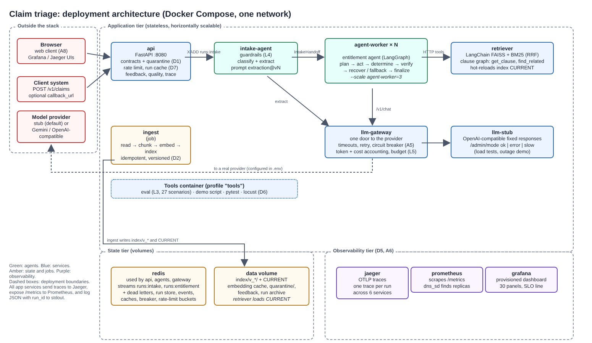
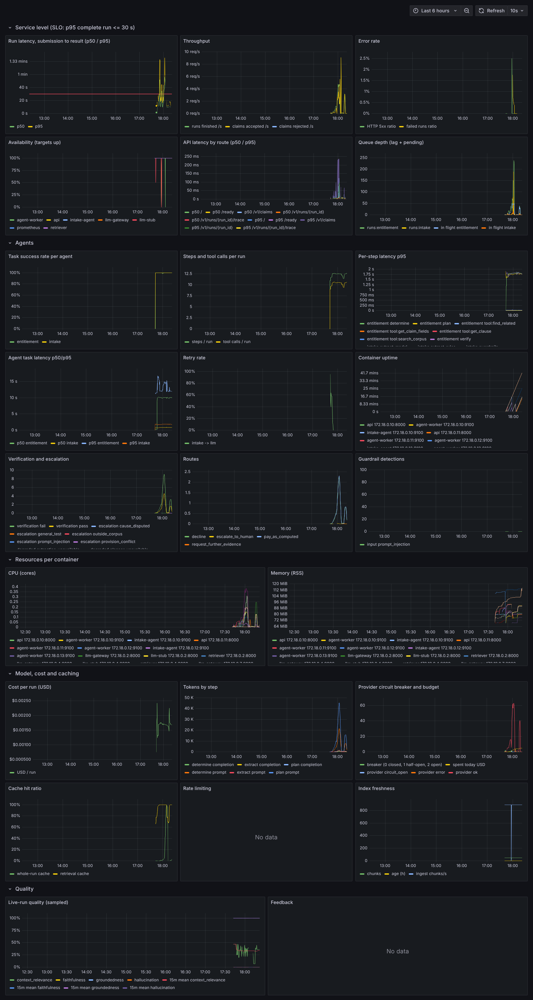

# Architecture and design



The diagram source is `docs/img/architecture.html`. A text version follows, with each deployment boundary drawn as a
box.

```
 OUTSIDE                         APPLICATION TIER (stateless, scale with replicas)
 ┌──────────────┐   HTTP   ┌─────────┐ runs:intake ┌──────────────┐ runs:entitlement ┌─────────────────────┐  HTTP  ┌───────────┐
 │ browser /    │────────▶│   api   │────────────▶│ intake-agent │─────────────────▶│ agent-worker × N    │───────▶│ retriever │
 │ client system│◀────────│ FastAPI │  (Redis     │ guardrails,  │  IntakeHandoff   │ entitlement agent   │ tools  │ FAISS+BM25│
 └──────────────┘ result/  └─────────┘   Streams)  │ extraction   │                  │ (LangGraph)         │        │ clause    │
        ▲         callback                         └──────┬───────┘                  └─────────┬───────────┘        │ graph     │
        │                                                 │ /v1/chat                           │ /v1/chat           └─────▲─────┘
 ┌──────┴───────┐                                         ▼                                    ▼                          │ loads
 │ model        │◀────────────── (real provider) ──── ┌──────────────────────────────────────────────┐   ┌──────────┐  │ CURRENT
 │ provider     │                                     │ llm-gateway: timeout, retry, breaker, cost   │──▶│ llm-stub │  │
 └──────────────┘                                     └──────────────────────────────────────────────┘   └──────────┘  │
                                                                                                                      │
 STATE TIER                                                    JOBS / TOOLS                                           │
 ┌────────────────────────────────────────────┐  ┌──────────────────────┐   ┌───────────────────────────────┐         │
 │ redis: streams, dead letters, run store,   │  │ data volume: index/  │◀──│ ingest (job): chunk, embed,   │─────────┘
 │ events, caches, breaker, rate-limit buckets│  │ v_*, CURRENT, cache  │   │ index; idempotent, versioned  │
 └────────────────────────────────────────────┘  └──────────────────────┘   └───────────────────────────────┘
 OBSERVABILITY: jaeger (OTLP traces), prometheus (scrapes /metrics, dns_sd), grafana (provisioned dashboard)
```

## 1. Services (D3)

| Service | Image target | Role | Scales |
|---|---|---|---|
| `api` | app | Validates claims against the contract and quarantines bad ones. Rate limits, run cache, `202 Accepted` plus a run id, status and trace endpoints, feedback, and the web client | replicas |
| `intake-agent` | app | Agent 1. Guardrails, disruption classification, entity extraction (rules plus model) | replicas |
| `agent-worker` | app | Agent 2. The entitlement agent: a LangGraph loop with tools, verification, recovery and fallback | `--scale agent-worker=N` |
| `retriever` | retriever | Serves hybrid search, `get_clause` and `find_related` over the current index, and hot-reloads it | replicas |
| `llm-gateway` | app | The only component that talks to the model provider. Timeouts, retry, circuit breaker, token and cost accounting, daily budget | 1 (breaker state is in Redis, so more would also work) |
| `llm-stub` | app | OpenAI-compatible stub with fixed responses and a realistic delay. Supports `/admin/mode` ok, error and slow | 1 |
| `ingest` | retriever | One-shot job: read, chunk, embed, index | job |
| `redis` | redis:7 | Queue (Streams with consumer groups), run store, caches, breaker, rate-limit buckets | 1 |
| `jaeger`, `prometheus`, `grafana` | upstream | Traces, metrics, dashboard | 1 |
| `eval`, `locust` | tools (profile `tools`) | Evaluation, demo script, tests, load generator | on demand |

## 2. Request lifecycle (A4)

1. `POST /v1/claims`. The API checks the strict Pydantic contract and cross-field rules. A failing request is
   written to quarantine (`/data/quarantine/*.json`, listed at `GET /v1/quarantine`) and answered with HTTP 422
   listing each field error. **No run starts.**
2. Rate limiting is a token bucket per `X-Client-Id`, implemented as a Lua script in Redis, plus a cap on the number
   of runs in flight per client. Requests over the limit get HTTP 429 with `Retry-After`.
3. The run cache key is a hash of the normalised claim plus the prompt, index and model versions. On a hit, the API
   returns the cached result at once. If the same claim is already running, the request attaches to that run
   (single-flight).
4. Otherwise a run record is created, a message goes onto `runs:intake` carrying the W3C `traceparent`, and the API
   returns **202** with a `run_id` and a status URL. The client polls `GET /v1/runs/{id}`, or supplies
   `callback_url`.
5. `intake-agent` consumes the message, produces an `IntakeHandoff` (`contracts/intake_handoff.schema.json`) and puts
   it on `runs:entitlement`. **This is the hand-off between the two agents (A2).**
6. An `agent-worker` replica runs the entitlement graph and stores the result, then fires the callback.

Workers ack a message only after the step succeeds. If a replica dies, another one takes over the pending message
with `XAUTOCLAIM` after 150 s. After 3 deliveries the run is closed as `failed`, escalated, and the message goes to
`runs:dead`. A run past `RUN_DEADLINE_S` is closed the same way. Neither case is ever returned as a confident
answer.

## 3. Agents (A1 to A3)

### Intake agent (no tools)

* **Guardrails** (`guardrails.py`). Text is NFKC-normalised and zero-width characters are stripped, then scored
  against injection patterns. If injection is detected, **the narrative is withheld** from every later model call
  and the run is flagged for escalation. Toxic language is redacted but does not reduce an entitlement.
* **Classification and extraction.** A deterministic rule extractor always runs. The model extraction prompt
  (`prompts/extraction/v*.yaml`) runs on the spotlighted narrative. The two results are merged, structured fields win
  over narrative text, and disagreements are recorded as `conflicts`.

### Entitlement agent (LangGraph, `agents/entitlement.py`)

```
plan ──tool──▶ act ──▶ plan ──finish/budget──▶ determine ──▶ verify ──pass──▶ finalize
                                                               ├─fail, attempts left──▶ recover ──▶ plan
                                                               └─fail, exhausted─────▶ fallback ──▶ finalize | escalate
```

**Tools** (LangChain `StructuredTool`, all served by `retriever` over HTTP):

| Tool | Purpose |
|---|---|
| `search_corpus(query, k, doc_id?, mode)` | Hybrid (FAISS dense + BM25, RRF k=60) or lexical search |
| `get_clause(clause_id)` | Exact provision text by id |
| `find_related(clause_id, relations)` | Walks the reference graph: what a provision cites, and which provisions cite it. Exemptions and conditions live in the second direction |
| `get_claim_fields()` | Returns the validated facts, so the planner never has to re-read the narrative |

**Planner.** In `hybrid` mode the model proposes the next action, using the planner prompt. A checklist guard
refuses "finish" until two things have happened: the provision that appears to apply has been expanded with
`find_related`, and searches derived from the text already read have run. Without a model, the checklist drives on
its own (degraded mode).

**Loop bounds.** At most `AGENT_MAX_STEPS=14` graph steps, `AGENT_MAX_TOOL_CALLS=12` tool calls,
`AGENT_MAX_WALL_S=90` s, and `AGENT_MAX_VERIFY_ATTEMPTS=2` verification attempts. LangGraph's recursion limit is
100. Three consecutive tool errors stop the research phase.

**Determine.** The deterministic rule engine (`rules/car_rules.yaml` and `engine.py`) evaluates the facts against the
CAR conditions. Each decision is tied to clause ids and to the phrases that must appear in them. In `hybrid` mode the
model also drafts a position with verbatim quotes, and that draft is the candidate answer.

**Verify (A3, `agents/verifier.py`).** A candidate is returned only if all of these pass:

| Check | Meaning |
|---|---|
| `citations_resolve` | Every cited clause was retrieved during this run |
| `quotes_in_text` | Every quote, and every required phrase, appears verbatim in the cited passage |
| `required_retrieved` | The conditions and exemptions that could remove the entitlement were read (F4) |
| `route_has_basis` | A decline cites a negative condition, a payment cites an amount provision, an escalation has reasons |
| `cites_decisive_provision` | A model answer cites every basis, amount and exemption clause the outcome depends on |
| `consistent_with_rules` | A model answer agrees with the engine on route and amount |

**Recover.** Recovery changes strategy rather than retrying the same thing. It looks up missing conditions with exact
`get_clause` calls, runs lexical searches on the phrases that failed, and re-determines with the verifier's feedback
in the prompt. **Fallback.** The engine's own position is verified independently. If that also fails, the run
escalates. Nothing unverified is ever returned.

**Output (F5 to F7).** The output has a route (`pay_as_computed`, `decline`, `request_further_evidence`,
`escalate_to_human`), the computed entitlement, facilities owed, citations with verbatim quotes, the escalation path,
the missing evidence, confidence, prompt versions, and cost and timings. Where the CAR and the airline charter
conflict, the regulation prevails and the conflict is reported (F8).

## 4. Retrieval: chunking and embedding strategy (L1)

**Corpus.** There are two documents, listed in `corpus/manifest.yaml`:

* `CAR`: a working-text reconstruction of DGCA CAR Section 3, Series M, Part IV. It has 35 chunks.
* `CHARTER`: a synthetic airline charter (12 chunks). We added it to exercise conflicts.

**Chunking: one numbered provision per chunk** (`retrieval/chunking.py`, `CHUNKER_VERSION=clause-2`).

* **Why not fixed windows.** In the CAR, the amounts and the condition that removes them sit in the same paragraph.
  Para 3.3.2 lists INR 5,000/7,500/10,000 *and* says no compensation is payable once the alternate flight is
  accepted. A 500-character window can separate the two. A retriever that finds the amounts and stops will then
  state an entitlement that does not exist, which is the failure the section 4.1 case is designed to expose.
* **Rules.**
  * A provision keeps its sub-paras (a) to (d) and its trailing conditions together. Chunks average 309 characters
    in the CAR, with a maximum of 1,071. Anything over 2,400 characters is split on sub-paragraph boundaries.
  * The heading path ("3 REQUIREMENTS > 3.3 Cancellation") and the document title are prepended to the embedded text.
  * Cross-references ("para 3.4.1", "paras 3.4.1 to 3.4.3") are extracted into `refs_out`, and the inverse into
    `cited_by`. That gives `find_related` a graph to walk in both directions (21 edges in the CAR).
  * Defined terms are extracted so the definitions in section 2 can be fetched.
* **Ablation.** Running `pipeline ingest --chunking fixed` builds fixed 800-character windows for comparison.

**Embeddings.**

* **Model.** The default (`.env.example`) is `sentence-transformers/all-MiniLM-L6-v2`, run locally on CPU at no cost.
  If the model cannot be downloaded and `EMBEDDING_ALLOW_FALLBACK=true`, the system uses deterministic
  feature-hashing vectors of word uni- and bi-grams instead.
* **Index records its backend.** The index stores which backend built it, and changing the backend triggers a
  re-embed instead of silently mixing two vector spaces.
* **Our measurements.** All numbers in this repository were measured with the hashing backend, because the build
  sandbox could not reach Hugging Face. BM25 carries the exact-term matching either way.

**Hybrid search.** FAISS (LangChain, cosine) and BM25 each rank a pool of `max(4k, 20)` results, and the two rankings
are fused with reciprocal rank fusion (k = 60). Paragraph numbers and terms like "block time" match lexically.
Passenger phrasing ("they put me on a later plane") matches densely.

**Re-embedding and updates (D2).** `python -m triage.retrieval.pipeline ingest`:

* **Idempotent.** A document whose file hash, version and chunker version are unchanged is skipped. A second run
  reports `up to date`.
* **Incremental.** Only new or changed chunks are embedded. Removed chunks are deleted from FAISS by id.
* **Content-addressed cache.** Vectors are cached under (model id, sha256(text)), so `--reembed` or a model change
  never has to re-parse documents.
* **Versioned.** Each change writes `index/v_<n>/` and then atomically repoints `index/CURRENT`. The retriever
  hot-reloads, and the last three versions are kept for rollback.
* **Freshness metrics.** `state.json` records build time, document versions, chunk count, embedding model and
  throughput. The retriever exports these as `index_age_seconds`, `index_chunks`, `index_built_timestamp_seconds`
  and `ingest_throughput_chunks_per_second`.

**Official CAR.** To use the official text, put the PDF in `corpus/raw/`, point the manifest at it, set
`provenance: OFFICIAL` and run `make ingest`. A PDF without a text layer is rejected with a message to OCR it
first.

## 5. LLM gateway and resilience (A5)

* **Per-call settings.** Every model call has a timeout (`LLM_PROVIDER_TIMEOUT_S`) and exponential-backoff retries
  with jitter (`LLM_MAX_RETRIES`). Only transient errors are retried: timeouts, 429 and 5xx.
* **Circuit breaker** (state in Redis, shared by all callers):
  * It opens after `BREAKER_FAILURE_THRESHOLD=5` consecutive failures.
  * While open it fails fast for `BREAKER_OPEN_SECONDS=30`.
  * It then allows a **single** half-open trial and closes when the trial succeeds.
* **Degraded path.** When the provider is unavailable, extraction uses the rule extractor, the checklist planner
  drives research, and the engine produces the position. That position still goes through verification, and the
  result is marked `degraded: true`.
* **Tool calls** to the retriever have their own timeouts (`TOOL_TIMEOUT_S`) and retries.
* **Costs.** Each call records prompt and completion tokens and its USD cost at call time, using the configured
  prices. `LLM_DAILY_BUDGET_USD` makes the gateway refuse calls once the budget is spent, which also triggers the
  degraded path.

## 6. Observability (D5, A6)

* **Logs.** JSON lines on stdout, each with `ts, level, service, run_id, correlation_id, agent, event`.
* **Traces.** OpenTelemetry sends OTLP over HTTP to Jaeger. The `traceparent` is carried *inside the stream
  messages*, so one trace spans api, intake-agent, agent-worker, retriever, llm-gateway and llm-stub. We measured a
  168-span trace across all six services.
* **Run reconstruction.** Every step appends an event to `run:<id>:events`, and `GET /v1/runs/{id}/trace` returns
  them in order:
  * plan decisions;
  * tool calls with their arguments, the passages returned and the latency;
  * model calls with the prompt version, tokens, cost and latency;
  * verification checks;
  * recovery;
  * the final result.

  That is enough to reconstruct any run without the logs. A typical run has about 48 events.
* **Metrics.** Prometheus discovers scaled replicas with `dns_sd_configs`. The Grafana dashboard
  (`observability/dashboards/claim-triage.json`, 30 panels) covers:
  * SLO latency with the 30 s line, throughput, error rate, availability and queue depth;
  * per-agent success rate, steps and tool calls per run, per-step latency and retry rate;
  * verification and escalation counts, routes and guardrail events;
  * CPU and memory per container;
  * cost per run, tokens by step, breaker state and budget;
  * cache hit ratios, rate limiting and index freshness;
  * live quality scores and feedback.



## 7. Security and configuration (D4, L4)

* **No secrets in the repository.** Every endpoint, model id and key comes from `.env`. The code has no defaults for
  endpoints or models, and `.env.example` documents every variable. `.env` is in `.gitignore` and `.dockerignore`.
* **Least privilege.** Only `llm-gateway` receives `LLM_API_KEY`. Services run as a non-root user (uid 10001).
* **Guardrails on input.** Injection detection and spotlighting, so narrative text is wrapped and labelled as
  untrusted data. The agent that holds the tools never sees a narrative that was flagged.
* **Guardrails on output.** The route must be one of the four allowed values, and amounts must not exceed the CAR
  caps. Language that authorises a payment ("approved", "we will pay") is rewritten into a recommendation, and every
  result carries a disclaimer that an officer decides.
